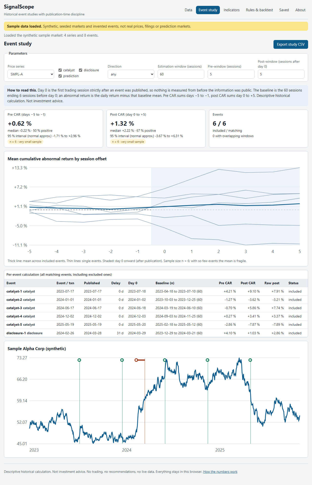

# SignalScope

An educational dashboard for **historical event studies**. Import daily prices, prediction-market
probabilities, catalyst dates and political or insider disclosures, then measure what happened around
those events, honestly: every event is used only from the first trading session **after it was
published**, the baseline period and sample size are always visible, and small samples are labelled
as small.



> **Status:** v0.1, built and tested locally. It is **not published or deployed**; run it locally
> (below). It is a descriptive, historical tool. It does not forecast, recommend or trade, and it
> makes no claim of guaranteed or multiplied returns. **Not investment advice.**

## What it does

- **Data with provenance.** CSV import of prices (with optional volume), event probabilities and
  events. Each series and event keeps its source, access level (public, licensed, restricted,
  synthetic) and retrieval date; events keep both their event or transaction date and their
  publication date. Import is all-or-nothing per file with line-numbered errors; missing values stay
  missing, never zero.
- **Timelines.** Price chart with each event's transaction date, the data-arrival delay and day 0
  (first session after publication); an events table with the delay in days. Dates can be edited, and
  a publication date before the event is refused.
- **Event study.** Pre and post cumulative abnormal returns (CAR) against a constant-mean baseline,
  with the baseline window and n shown for every event, exclusion reasons (short baseline, out of
  range, missing data, not yet tradable), overlap flags, a mean CAR path chart, a normal-approximation
  95 % interval and sample-size badges.
- **Indicators and relationships.** Rolling volatility, Wilder RSI, volume z-score shocks and lagged
  return correlations between two series, labelled as co-movement only, never causation.
- **Exploratory rules.** Combine two to six conditions that must cross at least two evidence types
  (event, volume, momentum, price, prediction market). The app reports how often the rule fired and
  what followed.
- **Backtest.** Train/test split by date, transaction costs per side, one position at a time,
  buy-and-hold comparison, max drawdown and uncertainty badges. Every signal and entry passes a
  no-look-ahead assertion; if one fails, no results are shown.
- **Saved work and exports.** Saved configurations, workspace JSON export and import, and CSV exports
  (event study, indicators, rule hits, backtest trades), each headed by provenance and parameter
  comments and protected against spreadsheet formula injection.
- **Sample market.** A seeded, synthetic market with invented companies, officials and a prediction
  market, marked by a banner and Sample badges wherever it appears.

## Quick start

Needs Node.js 20.19 or newer.

```powershell
npm ci
npm run dev        # http://localhost:5176/signal-scope/
npm run verify     # format, lint, types, unit tests, build, secret scan, e2e
```

`scripts\verify.ps1` and `scripts/verify.sh` run the same steps and stop on the first failure.

To try the import flow, use the invented example files in [examples/](examples): import
`demo-prices.csv` as a price series with symbol `DEMO`, then `demo-catalysts.csv` as events.

## The information-time rule

Day 0 for an event is the first session **strictly after** its publication date (the data carry
dates, not times, so a same-day release is treated as after the close). Rule conditions are evaluated
at a session's close and trades enter on the next session. The full rules are in
[docs/spec/00-data-and-time.md](docs/spec/00-data-and-time.md); calculations are in
[docs/spec/01-calculations.md](docs/spec/01-calculations.md) and
[docs/spec/02-rules-backtest-io.md](docs/spec/02-rules-backtest-io.md).

## Honest limits

No backend, accounts, live data or network calls. Daily data only: no intraday timestamps, exchange
holiday calendars or corporate-action adjustment. The baseline is a constant mean (no market model)
and the interval is a normal approximation. See [docs/known-limitations.md](docs/known-limitations.md).

## Documentation

[docs/architecture.md](docs/architecture.md), [docs/demo.md](docs/demo.md),
[docs/test-report.md](docs/test-report.md), [docs/handoff.md](docs/handoff.md),
[docs/backlog.md](docs/backlog.md), [SECURITY.md](SECURITY.md), [CONTRIBUTING.md](CONTRIBUTING.md),
[AI_ASSISTANCE.md](AI_ASSISTANCE.md).

## License

MIT, see [LICENSE](LICENSE). All bundled data (the sample market and the example CSVs) is synthetic.
